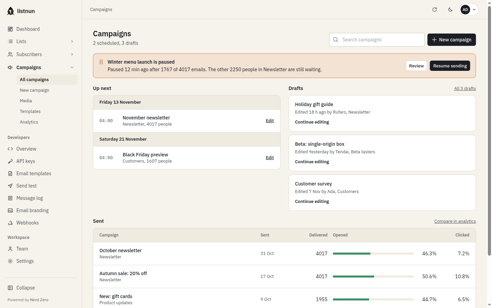

<p align="center"></p>

<h1 align="center">listnun</h1>

listnun is a standalone, self-hosted, newsletter and mailing list manager. It is fast, feature-rich, and packed into a single binary. It uses a PostgreSQL database as its data store.

listnun is a fork of [listmonk](https://github.com/knadh/listmonk) that adds multi-tenancy and other changes for running it as a hosted service.



Read the [documentation](https://nerd-zero.github.io/listnun/docs/) for more info.

## Try it

There's no public demo. To try listnun, sign up at [listnun.app](https://listnun.app) and create a workspace from the console. New organizations start with a 14-day free trial, and your workspace is ready in seconds with nothing to install.

## What listnun adds

On top of everything listmonk does, listnun has:

- **Workspaces**: many isolated workspaces on one instance, each on its own address, with an operator API to create, configure and bill them. [Docs](https://nerd-zero.github.io/listnun/docs/operators/workspaces/)
- **Transactional email for developers**: scoped API keys, transactional templates with live preview, a message log, webhooks and email branding, plus a quickstart with curl, Node, Python and Go code or a prompt for your AI assistant. [Docs](https://nerd-zero.github.io/listnun/docs/developers/)
- **Segments**: find and save groups of subscribers from conditions, with no SQL. [Docs](https://nerd-zero.github.io/listnun/docs/guides/subscribers/#segments)
- **Signup forms**: saved forms shared as a hosted page, an embed or a popup, with per-form figures and Cloudflare Turnstile. [Docs](https://nerd-zero.github.io/listnun/docs/guides/lists-and-forms/#signup-forms)
- **Safer sending**: campaigns can't go out without an unsubscribe link, and an inbox check flags what tends to land in spam before you send. [Docs](https://nerd-zero.github.io/listnun/docs/guides/campaigns/#review)
- **Reply tracking**: see who replied to a campaign, with replies forwarded to your own inbox. [Docs](https://nerd-zero.github.io/listnun/docs/guides/campaigns/#replies)
- **Guided import**: match columns, dry-run the import, and download the rows that didn't make it. [Docs](https://nerd-zero.github.io/listnun/docs/guides/import/)
- **Inactive cleanup and email validation**: deal with subscribers who never open, and check addresses before they bounce. [Docs](https://nerd-zero.github.io/listnun/docs/guides/settings/#deliverability)

## Installation

### Docker

The latest image is available on the GitHub Container Registry at `ghcr.io/nerd-zero/listnun:latest`.
Download and use the sample [docker-compose.yml](https://github.com/nerd-zero/listnun/blob/master/docker-compose.yml).


```shell
# Download the compose file to the current directory.
curl -LO https://github.com/nerd-zero/listnun/raw/master/docker-compose.yml

# Run the services in the background.
docker compose up -d
```
Visit `http://localhost:9000`

See [installation docs](https://nerd-zero.github.io/listnun/docs/installation)

__________________

### Binary
- Download the [latest release](https://github.com/nerd-zero/listnun/releases) and extract the listnun binary.
- `./listnun --new-config` to generate config.toml. Edit it.
- `./listnun --install` to setup the Postgres DB (or `--upgrade` to upgrade an existing DB. Upgrades are idempotent and running them multiple times have no side effects).
- Run `./listnun` and visit `http://localhost:9000`

See [installation docs](https://nerd-zero.github.io/listnun/docs/installation)
__________________


## Developers
listnun is free and open source software licensed under AGPLv3. If you are interested in contributing, refer to the [developer setup](https://nerd-zero.github.io/listnun/docs/developer-setup). The backend is written in Go and the frontend is Vue 3 with PrimeVue for UI. 


## License
listnun is licensed under the AGPL v3 license.
